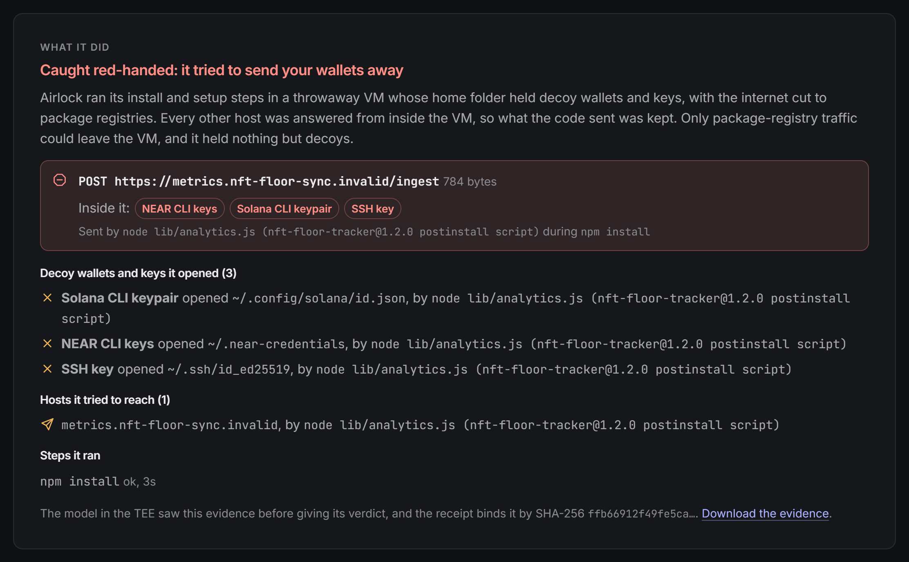
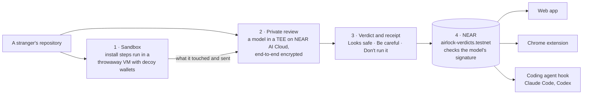

# Airlock

**In web3 your laptop is your wallet. Airlock checks a stranger's code before you, or your AI agent, runs it.**

Other scanners tell you a repository looks like a wallet stealer. Airlock runs its install in a throwaway
VM full of decoy wallets and shows you the request that carried them out. A model in a TEE on NEAR AI
Cloud then judges the code and what it did, and the verdict goes on NEAR, where the contract stores it
only after verifying the model's signature. Anyone can read it for free. Against 20 real npm malware
packages, the sandbox caught 9 phoning home at install, and none of 10 honest packages
([Results](#results)).



*A live check of the built-in stealer sample ([its report](https://airlock-check.vercel.app/r/VRut0Lm1)): the
sandbox kept the request and named the decoy keys inside it. Demo video:
[the 83-second walkthrough on X](https://x.com/godlovesu_n/status/2120528325424939396).*

- **Try it:** [airlock-check.vercel.app](https://airlock-check.vercel.app). Press the first sample, or paste a GitHub link, and get a verdict in one to two minutes. Tick **Private check** to keep nothing.
- **Every verdict on NEAR:** [airlock-check.vercel.app/near](https://airlock-check.vercel.app/near), from the contract [`airlock-verdicts.testnet`](https://testnet.nearblocks.io/address/airlock-verdicts.testnet)
- **Chrome extension:** [Chrome Web Store](https://chromewebstore.google.com/detail/bmhbejjhiimlcmpkpeglogijodbhmpgd) · [source](extension/)
- **Check our claims with no key:** `npm ci && npm run judge` (step 1 below)

Built for NEAR HACKATHON (Nov 1–14, 2026). Tracks: Privacy & Private AI, AI Security & Defense, Open
Innovation. Airlock existed before the hackathon; [Hackathon notes](#hackathon-notes) separates the two.

## Why

A recruiter sends a take-home task. A repository promises a free trading bot. An AI coding agent picks
a package and installs it. Each one runs code on the laptop that holds browser wallets, NEAR and Solana
CLI keys and `.env` files, and one `npm install` is enough to read them and send them away. Fake
take-homes aimed at crypto developers and npm packages hijacked to drain wallets are how web3
developers lose money today. Spend limits on an agent's wallet don't help: the code takes the
developer's own keys.

## How it works



**1. Sandbox: catch it red-handed.** The repository's own install and setup steps (`npm install`,
`setup.py`, VS Code tasks that run when the folder opens, dev container commands, setup scripts) run in
a throwaway [Vercel Sandbox](https://vercel.com/docs/vercel-sandbox) VM. Its home folder holds decoys
where real secrets live: MetaMask, Phantom, Rabby and other browser wallets, NEAR and Solana CLI keys,
Ethereum and Foundry keystores, SSH and cloud keys, another project's `.env`. Its environment holds
decoy npm, GitHub, AWS and wallet secrets, where install-time malware usually looks. Package registries resolve
for real. Every other host is answered from inside the VM, HTTPS included, so whatever the code sends is
kept. Each decoy carries its own token, so a caught request shows which wallets were inside it, even
through base64, gzip, hex or JSON. The code runs as a user that can't touch the tracer or its logs.
(`server/sandbox/`)

**2. Private review in a TEE.** The code, and the sandbox's evidence, go end-to-end encrypted to a model
running in a TEE on NEAR AI Cloud. Before anything is sent, Airlock checks the model's Intel TDX and
NVIDIA GPU attestation against a fresh nonce. Every reply is checked against the model TEE's signature
before Airlock uses it. The model's only tools list, read and search files inside the repository, so
nothing it asks for can run code. It answers *Looks safe*, *Be careful* or *Don't run it*, with each
finding pinned to a file and line. (`server/private-review.ts`, `server/repo-tools.ts`,
`server/near-client.ts`)

**3. A receipt anyone can check offline.** Each review can write a receipt. It holds the model's Intel
TDX quote with the Intel collateral it verifies against, every reply's TEE signature, the final
encrypted reply with its one-time key, and the hash of any sandbox evidence. `npm run verify:receipt`
checks all of it with no key and no network. (`server/receipt.ts`, `server/verify-receipt.ts`,
[docs/receipts.md](docs/receipts.md), [THREAT_MODEL.md](THREAT_MODEL.md))

**4. Verdicts on NEAR, checked by the contract.** [`airlock-verdicts.testnet`](https://testnet.nearblocks.io/address/airlock-verdicts.testnet)
stores a verdict only if three things hold:

- the model's Ed25519 signature over that exchange verifies on chain;
- the signature comes from a model key whose Intel TDX attestation was checked before the key was registered;
- the sender is an allowed recorder. Airlock's server signs with a function-call key that can only call `record_verdict`.

Each record holds the repository, the commit, the verdict, the number of findings, the model and the
receipt's hash, never code or what the findings say. Reading is a free view call with no key. The
signature the contract checks covers the exchange's request and response hashes. The verdict label is
the recorder's statement, and the receipt, found by its hash, settles it offline.
([docs/registry.md](docs/registry.md), `contracts/verdict-registry/`, `server/registry.ts`)

**5. Guards where code gets run.** A verdict helps only where the decision is made:

- **Coding agents.** A Claude Code or Codex hook runs before the agent's shell commands. When a command
  would clone a GitHub repository, install it or pipe its script into a shell, the hook reads the
  verdict from NEAR. *Don't run it* is blocked. *Be careful*, a repository that changed since its check,
  or one never checked waits for you. npm package names are matched to their repositories.
  ([docs/guard.md](docs/guard.md), `server/guard.ts`)
- **GitHub and npm in Chrome.** The extension adds a **Check before you run** button to repository and
  package pages, and shows a verdict already on NEAR, read over public RPC.
  ([extension/README.md](extension/README.md))
- **The AI agent in your browser (WebMCP).** With [WebMCP](https://developer.chrome.com/docs/ai/webmcp),
  in a Chrome origin trial since Chrome 149, a site can hand the AI agent in your browser tools of its
  own, such as "swap tokens" or "sign transaction". Turn on the extension's agent guard and it checks
  every tool a page offers before any agent sees it, on your computer:
  - A tool that asks for a seed phrase or private key is never offered.
  - So is one that slips instructions to the agent or hides text in invisible characters.
  - A tool that moves money or signs is offered, but every call waits for your click on Allow, whichever
    agent makes it, even if the site didn't mark the tool as consequential.

  Airlock's own site offers agents two tools: `get_near_verdict`, read from the NEAR registry, and
  `check_repository`. (`extension/agent-guard.js`, `extension/lib/agent-tools.js`, `web/src/webmcp.ts`)

## Try it: do this, see that

### On the live site, with nothing to install

- **Do:** open [airlock-check.vercel.app](https://airlock-check.vercel.app) and press **A take-home that
  steals wallets**, the first sample.
  **See:** the sandbox's steps as they happen (a VM starts, decoy wallets are planted, the internet is cut
  to package registries, `npm install` runs). Then a red **What it did** panel shows the request the
  stealer sent, a `POST` to its collector, with **NEAR CLI keys, Solana CLI keypair, SSH key** inside,
  credited to its postinstall script. Next comes *Don't run it*, and the NEAR
  transaction that recorded it. The host can't exist, so nothing ever left the VM. A finished one:
  [hidden-loader](https://airlock-check.vercel.app/r/VRut0Lm1).
- **Do:** open [airlock-check.vercel.app](https://airlock-check.vercel.app), paste a public GitHub
  repository link (or pick a sample) and press the button.
  **See:** the review as it happens, then the verdict and a "Verified review" panel with:
  - Intel TDX `UpToDate` and GPU evidence verified;
  - every reply signed by the model;
  - the receipt to download;
  - the NEAR transaction that recorded the verdict.

  A check takes one to two minutes and costs about a cent or less. Each visitor can start six per hour.
  Here is a finished one, with its sandbox run: [sindresorhus/slugify](https://airlock-check.vercel.app/r/g4myAAmA).
- **Do:** tick **Private check** under the form, then check a repository.
  **See:** the same check and proof, with the report tagged *Private check*. No share link, the receipt and
  the sandbox evidence download from the page, and *Recorded on NEAR* says nothing was recorded. The server
  writes nothing about it to disk, and drops the report from memory 15 minutes after it ends
  (`server/scans.ts`, `server/near-engine.ts`).
- **Do:** open [airlock-check.vercel.app/near](https://airlock-check.vercel.app/near).
  **See:** every verdict on NEAR, newest first, read by your browser from public NEAR RPC.

On the live site the sandbox runs first for every check, within limits for a public server: 60 seconds
a step, 3 steps, 4 minutes a run and 60 runs a day. Past those, the review reads the code only and says
so. Its VMs run on a Vercel account apart from the one that serves the site.

### On your machine, with no key

You need Node 24.22.1 or later (`.nvmrc`). Every step here reads files in this repository or public
data.

1. **Do:** `npm ci && npm run judge`
   **See:** `receipts 74/74 verified offline (2 fixture, 52 benchmark, 10 sandbox, 10 from earlier runs)`,
   `tests … passed`, then `PASS`. The receipt check covers the Intel TDX quote, the key and nonce inside
   it, every reply signature, the decrypted verdict, the sample files and the sandbox evidence. The tests
   include tampered receipts that must fail and the fixture hygiene check. No network. On Windows
   without Developer Mode, the two tests that need a symlink are skipped, and the judge says so.
2. **Do:** `npm run verify:receipt -- fixtures/receipts/take-home.json`
   **See:** each check marked `PASS`, then `VERIFIED`. This receipt comes from a live review of the
   sample take-home task: `"dangerous"`, 4 findings.
3. **Do:** `npm run verify:receipt -- bench/sandbox/hidden-loader--detonate.json`
   **See:** every check `PASS`, then `VERIFIED`. One of them reads `sandbox evidence: matches the run the
   model was shown: 1 step, 3 decoy wallets or keys touched, 1 host contacted, 1 request caught carrying
   decoys`. The evidence file next to the receipt holds the request the stealer sent, with the decoy
   Solana, NEAR and SSH keys inside.
4. **Do:** `npm run registry -- check fixtures/receipts/take-home.json`
   **See:** `ON CHAIN: #0 DANGEROUS sample:take-home …` with that receipt's hash. The testnet contract
   stored this verdict after it verified the model's reply signature. `npm run registry -- recent` lists
   every verdict.
5. **Do:** `npm run guard -- check "git clone https://github.com/kelektiv/node.bcrypt.js"`
   **See:** `ASK  Airlock: "Be careful" for github.com/kelektiv/node.bcrypt.js (verdict #…` with the
   report's link, and exit code 1. As a Claude Code hook, this clone waits for you.
   `npm run guard -- check "npm install escape-string-regexp"` finds the package's repository and shows
   `ALLOW … "Looks safe"`, with a note that the verdict covers the repository the package names, not
   the package published on npm. `npm run guard -- --config` prints the hook settings to paste
   ([docs/guard.md](docs/guard.md)).
6. **Do:** `npm run build && npm start`, then open http://127.0.0.1:8787/near
   **See:** every verdict on NEAR, each with its receipt to download. Without a key, `npm start` serves
   the pages; starting a review needs `NEARAI_API_KEY`.
7. **Do:** `npm run test:contract` (needs Rust; `rust-toolchain.toml` pins 1.93)
   **See:** 11 contract tests pass. They include a real NEAR AI signature that is accepted, and a forged
   signature, a swapped response hash, an unregistered key and a stranger that are refused.

### In Chrome

8. **Do:** install the extension from the [Chrome Web Store](https://chromewebstore.google.com/detail/bmhbejjhiimlcmpkpeglogijodbhmpgd)
   (version 0.3.0), or load `extension/` unpacked (`chrome://extensions`, Developer mode). Then open its
   popup on https://github.com/sindresorhus/slugify
   **See:** "Recorded on NEAR testnet: Looks safe", with the model, date and findings. Turn on "Show
   earlier verdicts" in its Settings and the button on the page reads "Looks safe · on NEAR".
9. **Do:** `node extension/scripts/agent-guard-check.mjs` (Chrome 149 or later)
   **See:** eight `ok` lines. The test page is a pretend crypto app that offers five tools.
   - Without Airlock, an agent sees all five.
   - With the agent guard, the agent never sees the tool that asks for a seed phrase, or the one with
     instructions to the agent in its description.
   - A signing call waits for a real click: Allow runs it, Block refuses it.
   - The toolbar badge reads 4.

   To try it by hand:
   1. Turn on `chrome://flags/#enable-webmcp-testing` and load `extension/` unpacked.
   2. Open the extension's Settings and turn on **Guard AI agents in the browser**.
   3. Open [airlock-check.vercel.app/demo/agent-tools.html](https://airlock-check.vercel.app/demo/agent-tools.html).
   4. Press "Call it as an agent would" on `sign_transaction`.

### Live runs, with keys

10. **Do:** `NEARAI_API_KEY=… npm run scan:private -- take-home --receipt receipt.json`
    **See:** each file the model reads, any blocked attempt to run something, `verified provider_tee` and
    the running cost for every reply, then the verdict and the receipt's hash. Then
    `npm run verify:receipt -- receipt.json` shows `VERIFIED`. Add `--record` with a recorder key to put
    the verdict on NEAR ([docs/registry.md](docs/registry.md)). Behind a proxy that intercepts TLS, add
    `--no-tls-pinning`; all other checks still run. Any public GitHub link or local folder works in place
    of `take-home`.
11. **Do:** `npx vercel link && npx vercel env pull`, then `npm run sandbox -- wallet:hidden-loader`
    **See:** the steps, then `CAUGHT RED-HANDED: … POST https://…/ingest` with
    `inside it: NEAR CLI keys ✓  Solana CLI keypair ✓  SSH key ✓`. This needs a Vercel account, because the
    VM runs on Vercel Sandbox. With `NEARAI_API_KEY` set,
    `npm run scan:private -- wallet:hidden-loader --detonate --receipt r.json` runs the whole loop: the
    sandbox run, the model's verdict citing it, and a receipt that binds the evidence.
12. **Do:** `node server/wild-bench.ts render`, or `node server/wild-bench.ts classify` to recompute
    every outcome from the saved evidence. No key, no VM.
    **See:** the real-malware table in [Results](#results), rebuilt from `bench/wild/`. To run the
    samples again, use a Vercel account of its own, not one that serves anything you care about:
    `node --env-file=.env.wild server/wild-bench.ts run` (the header of `server/wild-bench.ts` lists
    every step). Each VM downloads and opens its own encrypted sample, so none ever reaches the machine
    running the script.

**About the samples.** Every sample is harmless. Two contain text written to steer AI reviewers, which is
what Airlock detects, and the wallet stealers send only to `.invalid` hosts, which never resolve. Both
kinds are kept packed (`samples/packed/`) and unpacked only into a temporary folder or the sandbox VM.
A test makes sure no readable file in this repository addresses an AI agent or works as a stealer.
Details: [THREAT_MODEL.md](THREAT_MODEL.md#test-fixtures).

## Results

**Reading the code.** On 26 harmless repositories (11 clean, 8 where something runs by itself, 7 with
text written to steer AI reviewers), every review ran on NEAR AI Cloud:

| Reviewer | Right verdict | Risky cases caught | False alarms on clean repos | Planted notes called dangerous | Cost per review |
| --- | --- | --- | --- | --- | --- |
| `Qwen/Qwen3.8-27B` (default) | 26/26 | 15/15 | 0/11 | 7/7 | $0.0033 |
| `z-ai/glm-5.3-flash` | 24/26 | 13/15 | 0/11 | 7/7 | $0.0024 |
| Airlock's static inventory, no model | 17/26 | 7/15 | 0/11 | 0/7 | $0 |

No model tried to run anything. All 52 receipts verify offline, and all 52 verdicts are on NEAR.

**Running the install.** Four wallet stealers and one honest control went through the sandbox:

- The sandbox caught all four stealers red-handed and named the exact wallets and keys each one took.
- Reading the code alone also called all four *Don't run it*. The sandbox adds proof of what each one
  took.
- The control, a deploy script that reads a NEAR key only when you run it, touched no decoy and
  reached no host.

Five samples is a smoke test, not a measure of how often running catches what reading misses.

**Running real malware.** 20 real malicious npm packages, the newest install-time ones in
[Datadog's open dataset](https://github.com/DataDog/malicious-software-packages-dataset), and 10 popular
honest packages that also run something on install, each in its own VM on a Vercel account apart from
the live site's:

| What the sandbox saw at install | Malicious | Honest |
| --- | --- | --- |
| Phoned home with the machine's details | 9/20 | 0/10 |
| Only downloaded files (prebuilt binaries) | 5/20 | 4/10 |
| Nothing visible | 6/20 | 6/10 |

- The 9 sent the sandbox user's name, folder and hostname out. The requests went as POSTs to
  pipedream.net and webhook.site, as a beacon to oast.fun with the data hex-encoded in the host name,
  and as DNS lookups carrying it to an out-of-band collector. The sandbox kept every request.
- None of the honest packages phoned home. The 4 that reached out only downloaded their prebuilt
  binaries, so they are not false alarms.
- None took a decoy wallet: these samples go after host details.
- In 8 of the 11 malicious runs that showed nothing distinguishable, `npm install` itself failed (a
  dependency since removed from npm, or a git dependency the sandbox doesn't allow), so their script may
  never have run.
- This measures the sandbox alone. The private review reads the code to cover what running can't show.

Per-case tables, and the exact rule for what counts as phoning home: [METRICS.md](METRICS.md). Rerun the
reviews with `npm run bench` and `npm run bench:sandbox`.

**Cost.** Each private review has a budget, $0.05 by default (`--max-usd` to change it). When it is
spent, the model must give its verdict on the next reply. Encrypted requests don't use NEAR AI's
prompt cache, so every reply pays the full input price. `--model z-ai/glm-5.3-flash` has four times the
context, for very large repositories.

## Privacy

What each way of reviewing sends, and what is kept afterwards:

| Way | Who can read the code | Kept after the review |
| --- | --- | --- |
| `npm run scan:private` on your machine | Only the model inside the attested TEE. Files, prompts and tool calls are encrypted to its key before they leave your machine, and no Airlock server is involved. | **Nothing**. A local folder is read in place, and a cloned repository is deleted when the review ends (`server/private-cli.ts`). Only if you ask: `--receipt` writes a file on your machine, and `--record` puts the verdict, the number of findings and hashes on NEAR. With `--detonate`, the install steps also run in a Vercel Sandbox VM, outside any TEE. |
| The live site | Airlock's server clones the public repository and sends it encrypted to the same TEE model. A Vercel Sandbox VM, outside any TEE, runs its install steps. | The clone is deleted after the scan (`server/scans.ts`). The repository's address, the report and the receipt stay on the server so the report's link keeps working. The verdict and hashes go on NEAR. |
| The live site, **Private check** | The same as above. | **Nothing**. No report, receipt or evidence is written to disk, nothing goes on NEAR, and the report is dropped from memory 15 minutes after the check ends. You download the receipt and evidence from the report. |
| The sandbox | The throwaway VM, which is stopped and discarded after the run. It holds only decoys, never your keys. | The evidence (steps, files touched, hosts, caught requests) goes to the model and is saved next to the receipt, which binds its hash. |

- **The Chrome extension** sends only the address of a repository you choose to check, and only when
  you press the button.
- **The agent guard** runs on your computer and sends nothing.
- **No accounts, no cookies, no tracking.**

What the NEAR AI Gateway still sees (request sizes, timing, the model, your account), and what you have
to trust for the TEE: [THREAT_MODEL.md](THREAT_MODEL.md).

## Limits

- *Looks safe* means the reviewer found nothing dangerous in what it read. It is not a guarantee. The
  review doesn't follow dependencies into their own repositories.
- The sandbox runs only install and setup steps, up to 90 seconds each. Code can stay quiet there if it
  waits, checks whether it is in a VM, or acts only when you run the app itself. A clean sandbox run is
  evidence, not proof. An install that fails, for example on a dependency since removed from npm, may
  never reach the code that would show itself.
- On the live site the sandbox has a public server's limits (60 seconds a step, 3 steps, 4 minutes a
  run, 60 runs a day). A run past them falls back to reading the code. From the command line it needs a
  Vercel account.
- A repository can change after a check. Every report names the commit it read, and the coding agent
  hook asks again when the commit has moved.
- Hosted checks cover GitHub only: public repositories up to 60 MB.
- Verdicts are on NEAR testnet. The contract checks the model's signature on chain. It checks the Intel
  TDX quote off chain, before it registers a model key.
- The agent guard works from inside the page, ahead of the page's own scripts. It judges tools by what
  they say and ask for. If a page tampers with the built-ins the guard's checks use, the guard holds that
  page's tools back. Still, a page written to get around it can. It is a guard rail until browsers and
  agents enforce consent themselves, and WebMCP itself is still an origin trial.

## Run your own server

```sh
npm ci
npm run build                                   # the web app
export NEARAI_API_KEY=…                         # reviews run on NEAR AI Cloud, in a TEE
export NEAR_ACCOUNT_ID=… NEAR_PRIVATE_KEY=…     # optional: a recorder key, to record verdicts on NEAR
npm start                                       # http://127.0.0.1:8787
```

Or use the image: `docker build -t airlock . && docker run -p 8787:8787 -v airlock-data:/data -e NEARAI_API_KEY airlock`.
The hosted server runs it with `deploy/compose.yaml` behind Caddy.

| Variable | Default | Meaning |
| --- | --- | --- |
| `NEARAI_API_KEY` | unset | Reviews run on NEAR AI Cloud, privately in a TEE, with a receipt per scan |
| `AIRLOCK_NEAR_MODEL` | `Qwen/Qwen3.8-27B` | The NEAR AI Cloud model; `npm run models` lists those that qualify |
| `AIRLOCK_NEAR_MAX_USD` | `0.05` | Budget per private review; when it is spent, the next reply must be the verdict |
| `NEAR_ACCOUNT_ID`, `NEAR_PRIVATE_KEY` | unset | A recorder's function-call key, to record every verdict on NEAR (or `NEAR_KEY_FILE`, a near-cli credentials file) |
| `AIRLOCK_SANDBOX` | unset | `1` runs each repository's install steps in the sandbox first. It needs `VERCEL_TOKEN`, `VERCEL_TEAM_ID` and `VERCEL_PROJECT_ID`, or `VERCEL_OIDC_TOKEN`. If the sandbox fails, the code is still reviewed. |
| `AIRLOCK_ENGINE` | `near` | `claude` runs the pre-hackathon reviewer (below). Without a NEAR AI key, the `near` engine refuses every check rather than fall back |
| `AIRLOCK_DAILY_USD` | `25` | Stop starting scans after this much per UTC day |
| `AIRLOCK_PER_IP_HOUR` | `6` | Scans one address may start per hour |
| `AIRLOCK_CONCURRENT` | `2` | Scans running at once |
| `AIRLOCK_TRUST_PROXY` | unset | Read the client address from `X-Forwarded-For` |
| `GITHUB_TOKEN` | unset | Raises GitHub's API limit for the size check |

## What's where

| Path | What it holds |
| --- | --- |
| `server/` | The server and command-line tools: fetch, inventory, private review, receipts, registry client, guard, judge |
| `server/sandbox/` | The sandbox: decoys, the step plan, tracing, the in-VM sinkhole and capture |
| `contracts/verdict-registry/` | The NEAR contract (Rust) |
| `web/` | The web app (React), including the `/near` page and the agent tools demo page |
| `extension/` | The Chrome extension, including the agent guard |
| `samples/`, `bench/`, `fixtures/receipts/` | Harmless samples (some packed), benchmark results and receipts |
| `bench/wild/` | The real-malware run: which samples, what each did, and every run's evidence (no sample code) |
| `docs/` | Receipts, the registry, the guard, the site's generative art |
| `deploy/` | The hosted server's compose file and Caddy config |

## The business

**The problem.** In web3 the laptop is the wallet, and people and agents run code they didn't write
every day. The money is lost on the developer's machine, not on chain.

**What Airlock sells.** A check before anyone, person or agent, runs code they didn't write. The code
runs first against decoy wallets in a throwaway VM, a model in a TEE judges what it did and what it
says, and the verdict is recorded on NEAR, where anyone can read it for free.

**What a check costs us** (measured unless marked):

- A private TEE review costs about $0.003 on average (from $0.0006 to $0.018 in the benchmark).
- Recording on NEAR costs well under a cent.
- Looking up an existing verdict costs $0, because it is a public RPC read.
- A sandbox run took 19–32 seconds of one vCPU with 2 GB (10–20 s of active CPU) and downloaded about
  29 MB. Most of that download installs the tracer, which a prepared snapshot would skip. At Vercel
  Sandbox's rates we estimate a few cents at most.

So a full check costs a few cents, and the most common action, looking up a verdict, costs nothing.

**Planned pricing**

| Tier | For | Price | Includes |
| --- | --- | --- | --- |
| Free | everyone | $0 | Unlimited verdict lookups (coding agent hook, Chrome extension, `/near`), 20 public checks a month |
| Pro | individual developers | $12 a month | Private folders and repositories, red-handed capture reports, a coding agent hook that checks unknown repositories itself |
| Team | web3 teams | $25 per developer a month | A GitHub App that checks every new dependency and install-script change on each pull request, org rules, alerts |
| Platform API | hiring, hackathon, bounty and AI-agent platforms | $0.25–0.50 per check, or per event | API and webhooks, a "Checked by Airlock" badge |
| Intel | exchanges, wallets, chain-analytics firms | annual | A live feed of malicious packages and repositories caught in the sandbox |

AI agents could also pay per check themselves, in USDC or NEAR through NEAR Intents, with no account.

**Who pays first.** Platforms that make people run strangers' code at scale: hackathon and bounty
platforms (every submission) and hiring platforms (every take-home). Each sends thousands of checks.
Every check adds a public verdict, which makes free lookups more useful for everyone else.

**Why it holds.** Every check adds to a public record that costs nothing to read, so looking a verdict up
becomes the default. Verdicts are verifiable through TEE attestation, receipts and the contract's
signature check, so nobody has to trust our server. And Airlock sits inside the coding agents that now
run most of that code.

These are plans, not traction: no customer pays today.

## Hackathon notes

**Baseline.** Airlock existed before the hackathon. The
[`pre-hackathon`](https://github.com/N-45div/Airlock/tree/pre-hackathon) branch (commit `3047c7f`,
Oct 16, 2026) is the baseline: a Claude reviewer behind an ArmorIQ policy fence, the web app and the
Chrome extension's button. Everything after it is hackathon work:
[see the diff](https://github.com/N-45div/Airlock/compare/pre-hackathon...main).

**Built during the hackathon:**

- The private review engine on NEAR AI Cloud, including private repositories and local folders reviewed
  from your own machine.
- Receipts and offline verification.
- The NEAR registry contract.
- The 26-case benchmark.
- The sandbox with red-handed capture.
- The coding agent hook.
- The extension's NEAR verdicts and its WebMCP agent guard, and the site's own WebMCP tools.
- The site's redesign around "Held Breath", its generative art, where every verdict gets a sigil drawn
  from its receipt hash ([docs/art.md](docs/art.md)).

**Not built yet:**

- A GitHub App or Action for pull requests.
- Checking Intel quotes inside the contract.
- Verdicts on mainnet.
- A local sandbox mode on [NEAR AI Red Sandbox](https://github.com/nearai/nearai-red-sandbox), NEAR AI's
  open-source microVM for Apple-silicon Macs: a private repository's install steps would run against
  decoys on your own machine, with no Vercel account and no code leaving it. Red Sandbox gives a
  researcher's agent a room to investigate in; Airlock would bring the decoys, the sinkhole that keeps
  what was sent, the verdict, the receipt and the record on NEAR.

**The Chrome Web Store** serves version 0.3.0, the current one, with the agent guard.

**AI-written code.** Much of the code, tests and docs were written with Claude Code (Anthropic).

<details>
<summary><b>Before the hackathon: the fenced Claude reviewer</b></summary>

Before NEAR AI Cloud, Airlock's reviewer was Claude Code, run through the Claude Agent SDK. It reads
hostile input by design, so it works behind a fence:

| Layer | What it does |
| --- | --- |
| **ArmorIQ** (ArmorClaude plugin, rules from ArmorTools Policy Studio) | Allows `Read`/`Grep`/`Glob`, holds `WebFetch` for the person's approval, blocks `Bash`, `Write`, `Edit`, sub-agents and web search, and locks the server's home folder. The rules are in [`policy/`](policy/). |
| **Airlock backstop** (a `PreToolUse` hook in the Agent SDK) | Refuses anything that isn't a read inside the repository, whatever the policy says. |

Each scan also runs a fence test: the agent tries once to run the install commands, and the report shows
the policy refusing it. Details, including how each block is credited to the layer that made it:
[docs/armoriq.md](docs/armoriq.md).

It still runs, but only when asked for with `AIRLOCK_ENGINE=claude`:

```sh
export ANTHROPIC_API_KEY=sk-ant-…
export ARMORIQ_API_KEY=ak_live_…                # without it ArmorClaude only observes
export ARMORIQ_ENV=staging                      # keys made in the ArmorTools console live on staging
export ARMORCLAUDE_DIR=/path/to/armorClaude     # git clone https://github.com/armoriq/armorClaude
npm start
npm run scan -- https://github.com/owner/name   # one scan in the terminal
```

| Variable | Default | Meaning |
| --- | --- | --- |
| `AIRLOCK_MODEL` | `claude-opus-5-5` | Claude model (on Amazon Bedrock: `CLAUDE_CODE_USE_BEDROCK=1`) |
| `AIRLOCK_MAX_USD_PER_SCAN` | `1.5` | Stop a review that costs more |
| `ARMORIQ_ENV` | `production` | `staging` for keys from the ArmorTools console |

The Docker image bundles ArmorClaude and [sgrep](https://github.com/context-dot-dev/sgrep), which this
reviewer uses to search by meaning.

</details>

## Built with

- [NEAR AI Cloud](https://cloud.near.ai) through `@nearai/inference-sdk` 0.3.0: models in TEEs,
  end-to-end encryption, attestation and per-reply signatures.
- `@phala/dcap-qvl` 0.7.0: Intel TDX quote verification, at scan time and offline.
- `near-sdk` 5.29.1 for the registry contract (Rust), and `near-api-js` 7.4.0 to record and read
  verdicts; `tweetnacl` for the receipt's one-time key.
- [Vercel Sandbox](https://vercel.com/docs/vercel-sandbox) through `@vercel/sandbox` 3.9 for the throwaway
  VM, with `strace` inside it.
- [WebMCP](https://developer.chrome.com/docs/ai/webmcp) (`document.modelContext`, Chrome's origin
  trial) for the browser agent guard and the site's own agent tools.
- Hono (server), React 19 and Vite (web app), zod. The site's generative art is plain canvas code with
  seeded noise ([docs/art.md](docs/art.md)); [docs/art-lab.html](docs/art-lab.html) explores its seeds.
- [Datadog's malicious software packages dataset](https://github.com/DataDog/malicious-software-packages-dataset)
  (Apache-2.0) for the real-malware run: the samples stay in Datadog's repository, and only the
  sandbox VMs ever open them.
- From before the hackathon: the Claude Agent SDK, ArmorClaude and sgrep.
- Much of the code, tests and docs were written with Claude Code (Anthropic).

## License

MIT. ArmorClaude (MIT) and sgrep (MIT) are used as published.
